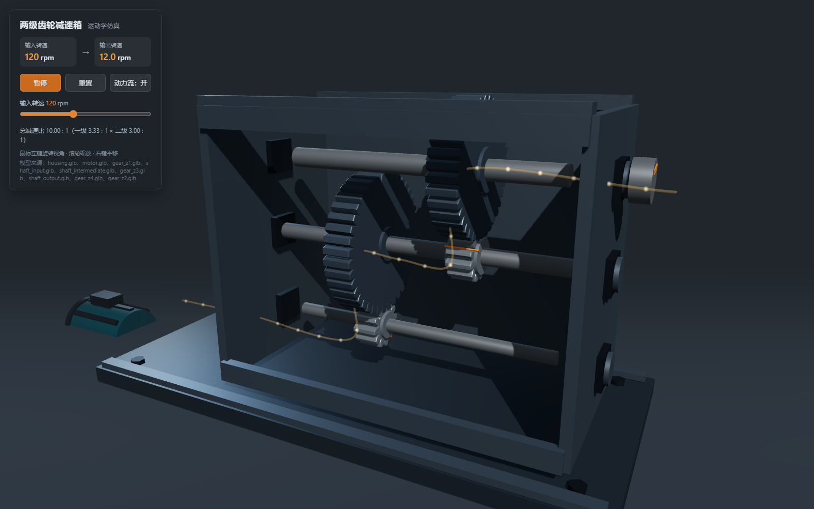

# 两级圆柱齿轮减速箱 · 交互式 3D 原理仿真

基于 **Three.js** 的多级齿轮减速箱运动学演示。还原「电机 → 两级圆柱齿轮副减速 → 输出轴低速转动」的完整动力传递过程，可清晰观察齿轮啮合同步、传动比匹配与转向变化。

> 仅做**运动学仿真**：按齿数比驱动各轴旋转，不计算应力、扭矩等力学量。



## 功能

- **两级减速传动链**：电机带动一级小齿轮 Z1，啮合驱动大齿轮 Z2；同轴的二级小齿轮 Z3 再驱动末级大齿轮 Z4，输出轴低速转动。
- **严格传动比**：齿数 12/40 × 12/36，总减速比 **10:1**；所有啮合齿轮转速按齿数比自动匹配，齿-槽相位全程同步，不错齿、不穿模。
- **运行控制**：默认自动运转，可暂停定格观察咬合位置、一键重置转角。
- **调速**：滑块调节输入转速（0–300 rpm），各级从动轮转速与输出转速实时跟随。
- **动力流粒子**（可选）：一串光点沿动力路径流动，标记能量传递方向，可一键开关。
- **相机交互**：鼠标左键旋转、滚轮缩放、右键平移（OrbitControls）。
- **写实场景**：环境光 + 双方向光 + 柔和阴影 + 淡雾效，剖视箱体让内部齿轮全程可见。

## 快速开始

```bash
npm install        # 仅安装 three（用于本地化依赖与离线生成 GLB）
npm start          # 启动零依赖静态服务器
```

浏览器打开 <http://localhost:8214>（端口可用 `PORT=xxxx npm start` 覆盖）。

> 必须通过 http 访问：ES Module 与 GLB 加载在 `file://` 下会被浏览器 CORS 拦截。

## 模型说明

`models/` 下 9 个 GLB 部件（箱体、电机、4 个齿轮、3 根轴）由 `tools/export-glb.mjs` 用与渲染端**同一套程序化几何**离线生成，面数适中、可直接替换：

```bash
npm run build:models   # 重新生成全部 GLB
```

运行时 `GLTFLoader` 加载这些 GLB；任一文件缺失或解析失败，会自动回退到内联程序化几何，项目始终可运行。

## 正确性验证

```bash
node tools/verify-meshing.mjs   # 纯数学：中心距、初始啮合、5000 时刻相位互补、线速度不变量、传动比
```

啮合判据为两轮在接触点的**齿-槽相位分数互补**（机器精度内残差 ≈ 1e-14），并校验节圆线速度不变量 `wA·Za + wB·Zb = 0`。当前 17 项全部通过。

## 目录结构

```
gearbox-sim/
├── index.html              # 页面与 UI（仅必要控制按钮）
├── css/style.css
├── js/
│   ├── main.js             # 入口：UI 绑定 + requestAnimationFrame 动画循环
│   ├── scene/world.js      # 渲染器/相机/灯光/雾/地面/OrbitControls
│   ├── geometry/
│   │   ├── gear.js         # 渐开线直齿轮程序化建模、轴
│   │   └── housing.js      # 底座、剖视箱体、轴承座、电机、联轴器
│   └── sim/
│       ├── kinematics.js   # 齿数/传动比/轴位/啮合相位/角速度（运动学核心）
│       ├── assembly.js     # 总装 + GLB 替换
│       ├── modelLoader.js  # GLTFLoader 封装与失败回退
│       └── particles.js    # 动力流标记粒子（可选）
├── models/                 # 9 个 GLB 部件
├── vendor/three/           # 本地化 three r160 + OrbitControls + GLTFLoader（离线可运行）
└── tools/
    ├── server.mjs          # 零依赖静态服务器
    ├── export-glb.mjs      # 离线生成 GLB
    ├── verify-meshing.mjs  # 啮合数学校验
    └── cdp-test.mjs        # Chrome DevTools 端到端功能测试
```

## 技术要点

- **依赖可控**：唯一运行时依赖 three.js（r160），已本地化到 `vendor/`，无需外网 CDN；无物理引擎。
- **渐开线齿廓**：标准 20° 压力角渐开线 + 拉伸成型，同模数、中心距等于分度圆半径和。
- **运动学驱动**：原生 `requestAnimationFrame` 按角速度积分各轴累计转角，暂停即冻结、重置即归零。
